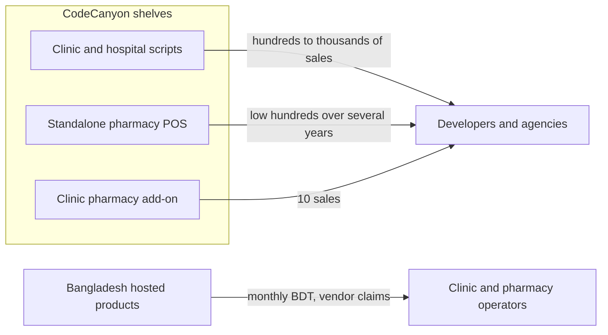

# Phase One: market research for review

Research date: 23 Oct 2026. No application code, schema, or tests exist. This repository holds research notes only. No buyer interviews were conducted. Figures below were read on the cited pages today unless marked as carried from the same-day clinic note in [docs/product/market-research.md](docs/product/market-research.md).

**Decision: No-Go for a CodeCanyon submission, and No-Go for starting the 12-phase build.** A later, separate approval could authorize a short PRD for one clinic with an in-house dispensary. That approval is not part of this research.

## Channel blocker

- **Verified, owner record today:** the project owner is not an Envato Code author. Recorded in [.cursor/plans/clinic-management-system.plan.md](.cursor/plans/clinic-management-system.plan.md). This new brief still names CodeCanyon as the sales channel, so that status needs confirmation if it has changed.
- **Verified:** [Envato’s author-intake article](https://help.author.envato.com/hc/en-us/articles/53981083605913-Author-applications-are-paused-new-authors-join-by-invitation-only), updated 25 Sep 2026, says new Market author accounts cannot be created, there is no application or waitlist, and Code is not in the current invitation set. Existing Code authors continue. No reopening date is published.
- Envato’s Node.js category requirements page was not opened. Do not treat a Next.js zip as review-ready.

## What the public sales counts support

CodeCanyon is separating into three shelves, not one “clinic plus pharmacy” shelf.

- Hospital and clinic scripts with years on the market sell in the hundreds to low thousands. Examples opened or recorded today: Smart Hospital, 2,036 sales at $89 (same-day note); [KiviCare Pro](https://codecanyon.net/item/kivicare-pro-clinic-patient-management-system-ehr-addon/30690654), WordPress add-on, $149, 1,229 sales, last update 29 Sep 2026; [Doxe](https://codecanyon.net/item/doxe-saas-doctors-chamber-prescription-appointment-software/28839037), $39, 514 sales, last update 19 Apr 2026; [InfyCare](https://codecanyon.net/item/infycare-laravel-clinic-appointment-booking-management/34157995), $49, 403 sales, last update 29 May 2026.
- Standalone pharmacy POS sells more slowly. [Medicine Care](https://codecanyon.net/item/pharmacy-management-software-laravel/36422063), $60, 146 sales over about 5 years, last update 19 Oct 2026, 20 ratings on the search card, star average not shown. [Medix](https://codecanyon.net/item/medix-the-pharmacy-pos-management-system/20479904), $75, 164 sales, last update 23 Oct 2023. [Acnoo Pharmacy SaaS](https://codecanyon.net/search/pharmacy%20management%20system), $29, 119 sales, last update 14 Aug 2026.
- The closest CodeCanyon product to this brief, [KiviCare Pharma](https://codecanyon.net/item/kivicare-tm-pharma-addon-pharmacy-inventory-management-in-laravel/60994895), is $89 with **10 sales**. The item page says it was created about 11 months ago and last updated 27 Jan 2026. The category search card said 9 Jul 2026. Those two dates disagree; the item page is the one cited here.
- A React and Node pharmacy listing on the same search page, AI Pharmacy SaaS, showed $98 and 18 sales, last update 20 Jul 2026. That does not support a premium price for the stack alone.
- **MitiMed:** no current public product page was found under that name. It is omitted rather than described.

**Hypothesis, not a survey:** marketplace buyers are buying a clinic script or a pharmacy script. Bangladesh clinic owners visible in vendor marketing pay a monthly hosted fee. Those are different buyers. No public count says which one would buy a new self-hosted Next.js product.

## Competitor comparison

Prices are the item price in US dollars. Buyer fees are extra where the page said so. “Documented” means the public listing or the vendor’s own page, not a code audit or a clicked-through demo.

### Integrated or adjacent

- **KiviCare Pharma add-on** — [item](https://codecanyon.net/item/kivicare-tm-pharma-addon-pharmacy-inventory-management-in-laravel/60994895). $89, 10 sales. Laravel, PHP 8.x, MySQL 8.x. Requires the KiviCare clinic product. Public features: pharma role, suppliers, categories and forms, expiry, batch-wise stock, purchase orders that update stock, doctor assigns a prescription to a pharma user, tax, dashboards. [Public docs](https://documentation.iqonic.design/kivicare-pharma/all-features/) say completing a purchase order and updating payment status adds quantity to medicine stock. FEFO, barcode, and strip-to-tablet conversion were not in that feature list. Install is an add-on zip uploaded into KiviCare admin, from the integration doc. Reviews were not opened.
- **KiviCare Laravel clinic** — search excerpt of [item 53137285](https://codecanyon.net/item/kivicare-complete-clinic-management-system-laravel-flutter/53137285) showed $149, 308 sales, 4.47 from 17 reviews. Full page was not saved separately. Listed scope is appointments, encounters, billing, telemedicine, multi-clinic, Flutter apps. Pharmacy is the separate add-on above. Vendor site also shows a service pack from $599 or $799; that is a service price, not the CodeCanyon item price.
- **KiviCare Pro** — WordPress add-on, $149, 1,229 sales, 73 ratings on the author portfolio, star average not opened, last update 29 Sep 2026. Clinic EHR, appointments, encounters, multi-clinic, RTL. Pharmacy is not this item.
- **InfyCare** — $49, 403 sales, Laravel, last update 29 May 2026. Item page covers multi-doctor clinic, visits, prescriptions, roles, currencies, public demo. It does not mention batches or FEFO. [InfyOm admin docs](https://infyom.com/docs/infy-care/admin-panel.html), from a search excerpt, describe medicine categories, brands, a quantity, purchases, used medicine, and medicine bills. That is a stock counter, not evidence of batch-level FEFO.
- **Doxe** — $39, 514 sales, CodeIgniter, PHP 7.x–8.x, MySQL 5.x, last update 19 Apr 2026. Chambers, serials, appointments, a drug list, printed prescriptions, install wizard, PayPal and Stripe. Changelog adds bulk drug upload and millilitre notes. No batch, expiry, receiving, or dispensing stock movement is described.
- **Smart Hospital** — same-day note: $89, 2,036 sales, CodeIgniter, last update 11 Aug 2026. Hospital scope includes pharmacy. On the first page of 2,304 comments, support said pharmacy billing does not follow a prescription number the way pathology billing does. Install docs require PHP, MySQL, Apache, writable files, and a web installer. The full thread was not read.

### Standalone pharmacy

- **Medicine Care** — $60, 146 sales, Laravel 11, PHP 8.x, MySQL 8.x, created about 5 years ago, last update 19 Oct 2026, version text 2.5.2. Documented: POS, cash, card, MFS, due, returns, partial refunds, batches, expiry, FEFO, low-stock and expiry alerts, purchases, purchase returns, prescriptions that convert to a sale, multi-language, PWA, cPanel and local install videos. Multi-store is named as an add-on. The first part of 154 comments was read, not the whole thread. Verified from those comments and author replies: a buyer cannot currently change a product’s category and units after entry, and the author tied that to architecture; update zips are separate from the install zip and buyers hit checksum and `UPDATE_HMAC_SECRET` errors; activation uses license.ayaantec.com, with about a 7-day unactivated window and a periodic check about every 24 hours, after which an offline install locks when the grace date passes; the author said there is no permanent offline license; barcode label printing is a separate add-on still described as in review; FEFO takes one sale line from one batch, and staff can pick a batch; issuing stock without an invoice is custom work. This is the strongest current pharmacy incumbent.
- **Medix** — $75, 164 sales, Laravel, PHP 8.x, MySQL 8.x, created about 9 years ago, last update 23 Oct 2023. Search-index feature text includes POS, CSV medicines, stock, suppliers, supplier payments, purchase orders, purchase returns, multi-store, and accounting reports. A 30 Dec 2022 changelog line says Laravel 8 and Vue 3. Batch, expiry, FEFO, and barcode were not confirmed on the page text captured today. The listing is three years without an update.
- **Acnoo Pharmacy SaaS** — $29, 119 sales, 9 ratings on the search card, Flutter and PHP, last update 14 Aug 2026. An earlier excerpt of the item page showed 106 sales and a 22 Jan 2026 changelog. The search card is the figure used here. It is a pharmacy SaaS with a mobile app, not a clinic record.
- **MyMedicine** — $49, 3 sales, Flutter, last update 14 Aug 2026. Author text lists sales, purchases, expired products, barcode labels, and prescription orders. Too new and too small to treat as demand.
- **GST Enabled Pharmacy** — search excerpt only: $249, 2 sales. Not used for pricing. Feature claims were not re-read on a saved item page.

### Bangladesh vendors

These are vendor descriptions, not independent audits. No sales counts were published on the pages opened.

- **[Bisnesy pharmacy](https://bisnesy.com/pharmacy-software)** — hosted POS from ৳499 per month, 7-day trial, 30-day refund claim. Vendor states 26,000+ Bangladesh brands, batch and expiry on purchase lines, tablets-per-strip conversion, daily alert inside 7 days, and credit ledgers. The same page states it does not store prescriptions or patient records and does not file with the DGDA. The medicine database is their data; this product must not copy it.
- **[ShifaSoft homepage](https://shifasoft.com/)** — hosted hospital ERP. Vendor claims 200+ facilities, 5 lac+ patients, and 99.9% uptime. Those claims were not checked. Pharmacy bullets: stock, expiry, prescription-linked dispensing, suppliers, reorder alerts. Clinic marketing on that page emphasizes queue, prescription, billing, and records. Displayed prices: Diagnostic ৳3,000 per month; Hospital ৳8,000 per month, which includes a line written “Full Pharmacy (LIS)”; Enterprise custom. Prices exclude VAT. Cloud or on-premise is claimed. A separate prescription page, seen in search results and not fully fetched, listed Starter ৳999, Professional ৳1,499, and Clinic ৳3,999 per month, with pharmacy integration marked optional on the clinic plan. Treat that as a second price table, not the homepage price.
- **ChamberBD and OCN**, from the same-day clinic note: serials, new and follow-up fees, Bangla and English, recorded bKash and Nagad, A4 or A5 print. ChamberBD states a 23,429 medicine catalogue. That catalogue was not recounted and must not be copied.
- **Shafa Care** clinic page, search excerpt: describes an e-prescription arriving at a dispensary as a sale, with batch and expiry. No price was captured. Not a code review.

## Buyer, personas, and the preference question

**No interviews were run.** The personas below are working profiles for a later interview, not findings from customers.

- **Ideal first operator, if a product is ever built:** one outpatient site, about 2–10 doctors, a receptionist, and a dispensary counter. The doctor writes the prescription. The dispenser chooses a valid batch and records what actually left the shelf. Consultation money and medicine money stay distinguishable.
- **CodeCanyon buyer profile, from Medicine Care presales:** a developer asking whether source is editable, whether a LAN install works, and whether a license check will lock an offline PC. That buyer compares install effort and PHP hosting, not clinical workflow essays.
- **Bangladesh operator profile, from vendor pages only:** serial or token, Bangla prescription print, strip and loose tablet, expiry before write-off, supplier dues, and a recorded mobile-wallet reference. Willingness to pay on those pages is a monthly fee from ৳499 to ৳8,000, plus setup, not a $59 script.
- **Doctor profile:** a short prescription with brand or generic, dose, duration, and print. Doxe’s 514 sales and the prescription plans above support demand for that slice. They do not show demand for the doctor to manage stock.
- **Pharmacist profile:** batch, expiry, and a quantity that matches the strip or the tablet. Bisnesy states this as the costly failure mode. It also states that it stops before the patient record.

Preference evidence, kept separate from the hypothesis: both standalone pharmacy scripts and clinic scripts have public sales; the integrated add-on has 10; Bangladesh vendors sell both a pharmacy that refuses prescriptions and a hospital suite that advertises prescription-linked dispensing. The combined workflow is a documented local operating model. It is not a proven CodeCanyon category.

## SWOT

- **Strengths to design toward:** one prescription-to-dispense trail; stock increases only on a receipt; prescribed quantity stored separately from dispensed quantity; Docker install; TypeScript strictness; a license check that cannot lock the clinic out of its own records. Medicine Care’s author described the opposite lock behavior.
- **Weaknesses:** no author account; no interviews; no existing code; Next.js listings visible today have tens of sales; a maintained Laravel pharmacy already advertises FEFO at $60.
- **Opportunities:** Smart Hospital support said prescription-numbered pharmacy billing was absent; InfyCare’s public item page does not document batch FEFO; KiviCare’s public docs tie stock increase to purchase-order completion; Medicine Care’s public comments show category and unit edits, update packaging, and offline license locks as live friction. Packaging conversion is documented by Bisnesy and absent from the CodeCanyon feature lists read today.
- **Threats:** buyers stay on cPanel PHP; a new author cannot upload; copying a medicine database creates a legal and licensing problem; support load grows with every extra module, as the Smart Hospital thread already shows.

## Differentiation and price test

Positioning that matches the evidence is a self-hosted dispensary attached to the visit, with an audit trail from prescription line to batch movement to invoice line. Competing by listing more hospital modules, or by being Next.js, is not supported by the sales counts.

Do not use these as claims until they exist in a reviewed build: FEFO that refuses expired, quarantined, and blocked batches; partial dispense; idempotent stock updates; goods receipt separate from the purchase order; integer strip and tablet conversion; English first with a Bengali translation; currency, time zone, and print layout in settings.

**Price hypothesis, not a list price.** The $59–$89 test range sits on top of InfyCare at $49, Medicine Care at $60, Medix at $75, and KiviCare Pharma at $89. KiviCare Pharma’s 10 sales argue against opening at $89. Node listings at $98 with 18 sales argue against a stack premium.

- If a listing ever exists, test a regular license at **$59**. Move to **$69** only after a demo shows goods-receipt stock, partial dispense, and unit conversion. Leave **$89** unused unless the finished scope is visibly broader than Medicine Care and still simple to install.
- Compare early sales with Medicine Care’s 146 sales over about five years, not with Smart Hospital’s 2,036. No monthly forecast is justified.
- Extended-license price belongs to Envato’s upload form. Do not copy another author’s extended price.
- For a Bangladesh clinic conversation, ask what they pay per month and what implementation costs. ShifaSoft’s displayed hospital plan is ৳8,000 per month. A $59 script price is a developer price. It is a poor proxy for what a clinic owner pays.

## Recommended MVP, only if a later plan approves a build

This is narrower than Phases Three through Eight of the brief. The full pharmacy POS, ecommerce, multi-branch, laboratory, inpatient, and accounting suite stay in the roadmap.

- One clinic per installation. Permissions for administrator, doctor, receptionist, and dispenser, with extra permissions assignable rather than hard-coded job titles.
- Patients, doctor schedules, appointments that the database rejects when they overlap, check-in, and a queue.
- Consultation note and prescription. Saving the prescription does not change stock.
- Clinic-entered medicines. No bundled national catalogue.
- Batches with lot, expiry, cost, and quantity. Stock rises on a goods receipt, including a partial receipt. Expired or blocked batches cannot be dispensed.
- Dispenser records the quantity actually issued, which may be less than the prescribed quantity. Default batch choice is first-expiry-first-out. The dispenser can pick another valid batch.
- One invoice can carry the consultation charge and the dispensed lines. Dispensing does not create a second copy of those lines.
- Recorded payments and an outstanding balance. Cash, card, and a mobile-wallet reference such as bKash or Nagad, with no live gateway.
- Strip and tablet, stored as an integer base unit. Fractional tablets rejected when the unit forbids them.
- Low-stock and near-expiry lists. Audit rows for prescriptions, dispensing, stock, and payments.
- Docker Compose, setup wizard, synthetic demo data, English interface, Bengali as a translation, configurable currency and time zone.
- License activation isolated from the clinical database, with local use continuing when a license server is unreachable.

Deferred until a buyer asks and a new plan says so: barcode POS, cashier shifts, walk-in retail as a separate mode, supplier returns, stock counts, inter-branch transfers, online store, laboratory, beds, telemedicine, live payments, and a scraped medicine database.

## Interview guide to run before a PRD

Eight to ten conversations, recorded as notes, not as market-size numbers. Ask clinic owners, one doctor, one dispenser, and two people who have bought a CodeCanyon medical script.

- Walk through yesterday’s last prescription: who typed it, who handed over the medicine, who took the money, and where the stock number changed.
- Ask what happens when the strip is opened and two tablets are sold.
- Ask what they do with a short supply, an expired box, and a supplier who delivers part of the order.
- Ask what they pay now, whether they will install Docker or only cPanel, and whether English screens with Bangla print is acceptable.
- Ask CodeCanyon buyers which file they last bought, how long install took, and whether they would pay $59 or $89 for a dispensary attached to the visit.

Until those notes exist, the MVP above is a scope proposal, not validated demand.

## Go / No-Go

**No-Go.** Evidence: no Code author account, Envato’s 25 Sep 2026 pause on new Code authors, an incumbent pharmacy script updated four days ago at $60 with the core inventory claims already on the listing, and a clinic-pharmacy add-on with 10 sales. Building the brief’s full sequence would spend the largest cost on a channel this owner cannot currently enter, and on modules the sales counts do not single out.

A private build for a named clinic remains possible later. It needs its own approval, after at least the interviews above or a written commitment from that clinic. This research does not approve a PRD, schema, or repository of application code.

## If this review is accepted

Update [docs/product/market-research.md](docs/product/market-research.md), [docs/roadmap.md](docs/roadmap.md), and the checklist so the pharmacy evidence and this No-Go replace the earlier outpatient-only recommendation. Leave the PRD, architecture, and application blocked.
